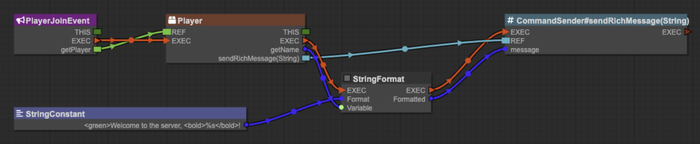

# PluginBlueprint

PluginBlueprint is a visual editor for Paper plugins (Minecraft 26.3).
You create plugins by adding and connecting nodes, without writing code.



## Download

Download the latest version from
[GitHub Releases](https://github.com/InventivetalentDev/PluginBlueprint/releases/latest).

- Windows: `.exe` installer.
- macOS: `.dmg` or `.zip`, for Apple Silicon.
- Linux: `.AppImage` or `.deb`.

## Documentation

1. [Getting started](https://github.com/InventivetalentDev/PluginBlueprint/wiki/Getting-Started): install the app and compile your first project.
2. [Examples](https://github.com/InventivetalentDev/PluginBlueprint/wiki/Examples): build five plugins from steps or downloadable snippets.

The documentation source is in [`docs/`](docs/Home.md).

## Support

PluginBlueprint is free and open source. If it helps you, you can [pay what you want](https://inventivetalent.shop/l/pluginblueprint?layout=profile).

## Requirements

- Internet access when you create a project (to download or check the Paper server, and Java if needed).
- Java 25 or newer to compile. If a suitable JDK is missing, the app offers to download one.

## Development

Use Node.js 24.

```sh
npm ci        # Install dependencies.
npm start     # Start the app.
npm test      # Run the tests.
npm run dist  # Build an installer for your platform.
```
