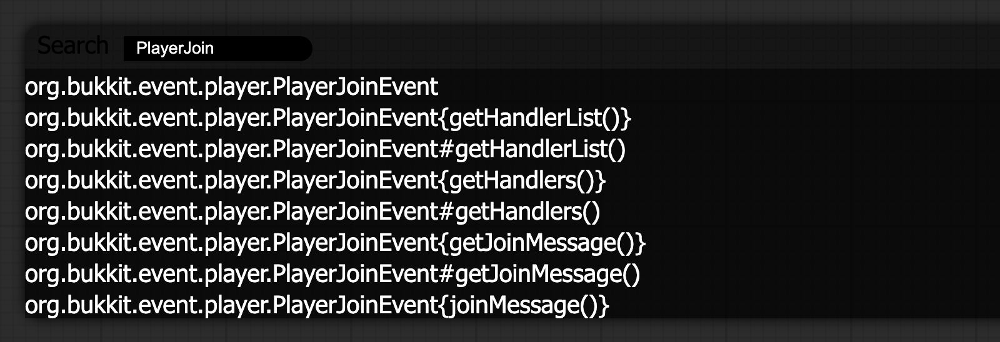
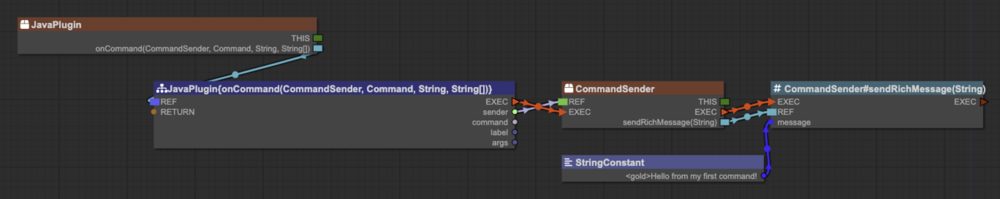
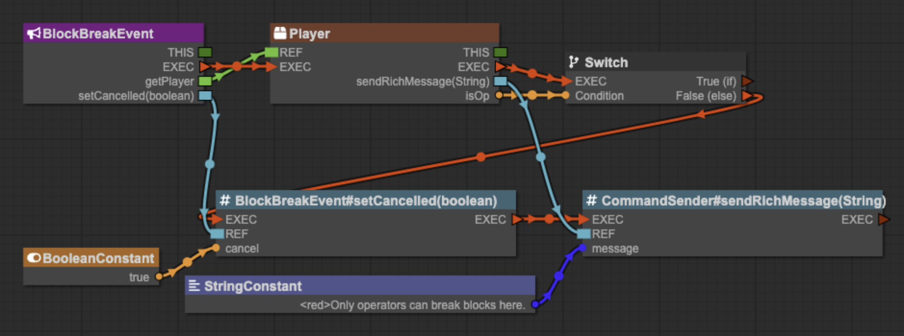
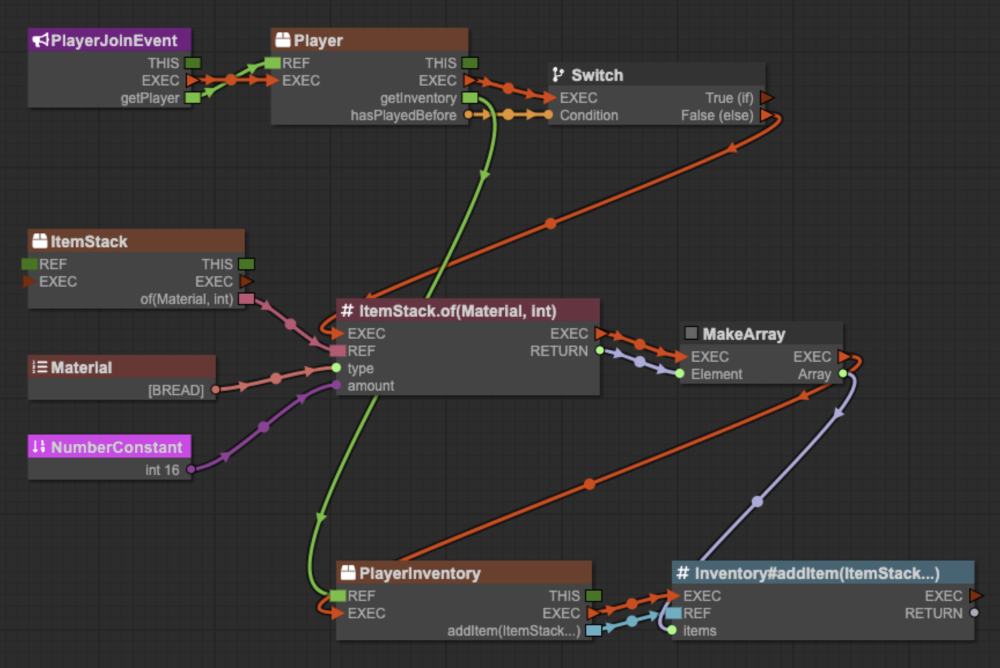
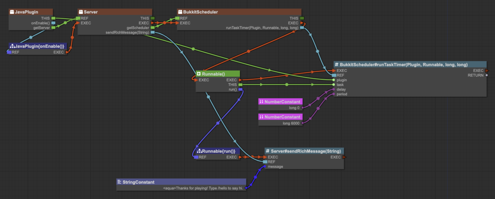

# Examples

Build these recipes in separate projects from [Getting started](Getting-Started.md).
For each recipe, choose either the snippet or the **Build it yourself** steps.
Use the **Try it** steps after either approach.

## Import a snippet or find a node

1. Follow the recipe's **Download snippet** link and save the `.pbs` file.
2. In your project, choose **File → Import Snippet** and select the saved file.
3. For the hello command, also register `hello` as described in its recipe.
   Importing a snippet adds nodes to the graph, not command declarations.

To build a graph yourself, double-click an empty part of the canvas and search
for part of a class name, such as `PlayerJoin`.



If an output is hidden, right-click the node and choose **Outputs** to enable it.
Double-click an output to create its matching node already connected.
To create a connected constant, double-click a `String`, number, or `boolean`
input. To change the constant, right-click it and open **Properties**.

All five recipes were built in the app and compiled against Paper 26.3.
Their exported `.pbs` files were imported back and compiled again.
The hello command and timed broadcast also ran on a Paper 26.3 server.
The join message, block protection, and starter kit were checked by compiling
only; their in-game behavior was not tested.

## Send a join message

Send each joining player a green welcome message with their name in bold.


[Download snippet](https://raw.githubusercontent.com/InventivetalentDev/PluginBlueprint/master/docs/examples/join-message.pbs)

Save the file, then use **File → Import Snippet** to add it to your project.

### Build it yourself

1. Add a `PlayerJoinEvent` node.
2. On that node, double-click `getPlayer` to create a connected `Player` node.
3. On `Player`, enable the `getName` output through **Outputs**.
4. On `Player`, double-click `sendRichMessage(String)` to create its method node.
   It is named `CommandSender#sendRichMessage(String)` because the method is
   declared on `CommandSender`.
5. Add a `StringFormat` node.
6. Double-click its `Format` input to create a String constant.
   Set the constant to `<green>Welcome to the server, <bold>%s</bold>!`.
7. Connect the `Player` output `getName` to the `StringFormat` input `Variable`.
8. Connect `StringFormat` output `Formatted` to the method's `message` input.
9. Connect the `EXEC` outputs and inputs in this order:
   `PlayerJoinEvent` → `Player` → `StringFormat` → `sendRichMessage`.
10. Choose **File → Save**.

### Try it

1. Choose **Compile → Generate Code, Compile, Package**.
2. Choose **Run → Start Server**.
3. Follow [Testing your plugin](Testing-your-Plugin.md) to join from Minecraft 26.3.
4. Check for the green welcome message with your name in bold.

### How it works

`PlayerJoinEvent` starts the chain when a player joins. `StringFormat` uses
Java's `String.format`: `%s` is replaced by the `Variable` input, which holds
the player's name. `sendRichMessage` reads the MiniMessage tags in the result.

## Create a hello command

Add a `/hello` command that replies with `Hello from my first command!`.



[Download snippet](https://raw.githubusercontent.com/InventivetalentDev/PluginBlueprint/master/docs/examples/hello-command.pbs)

Save the file, then use **File → Import Snippet** to add it to your project.
Register the command even if you use the snippet.

### Build it yourself

1. Open **Edit → Edit Project Information**.
2. Under **Commands**, click **+**.
3. Set **Name** to `hello`, **Description** to `Says hello`, and **Usage** to `/hello`.
4. Click **Save** in the command window, then **Save** in the project information
   window. If you imported the snippet, continue at **Try it**.
5. Add a `JavaPlugin` node. It represents your plugin and has no inputs.
6. Through **Outputs**, enable `onCommand(CommandSender, Command, String, String[])`.
7. Double-click that output to create `JavaPlugin{onCommand(...)}`.
   Its outputs include `EXEC`, `sender`, `command`, `label`, and `args`.
8. Double-click `sender` to create a connected `CommandSender` node.
9. On `CommandSender`, double-click `sendRichMessage(String)`.
10. Double-click the method's `message` input to create a String constant.
    Set it to `<gold>Hello from my first command!`.
11. Connect the `EXEC` outputs and inputs in this order:
    `onCommand` → `CommandSender` → `sendRichMessage`.
12. Choose **File → Save**.

### Try it

This recipe ran on Paper 26.3 and produced the console output shown below.

1. Choose **Compile → Generate Code, Compile, Package**.
2. Choose **Run → Start Server**.
3. In the log window's command box, type `hello` and press Enter.
4. Check for this output:

   ```text
   Hello from my first command!
   ```

5. To try it in-game, join as described in [Testing your plugin](Testing-your-Plugin.md)
   and type `/hello`. The message uses gold formatting in-game.

### How it works

Paper sends a command to your plugin only if you declare it under **Commands**.
`onCommand` runs for every command your plugin declares. If you add more than
one command, compare `command` → `getName` with `String#equalsIgnoreCase` and
branch with a `Switch` node. `sendRichMessage` reads tags such as `<gold>`
and `<bold>`; see the [MiniMessage format](https://docs.papermc.io/adventure/minimessage/format/).

## Protect blocks from non-operators

Cancel block breaking for players who are not operators and send them a red message.



[Download snippet](https://raw.githubusercontent.com/InventivetalentDev/PluginBlueprint/master/docs/examples/block-protect.pbs)

Save the file, then use **File → Import Snippet** to add it to your project.

### Build it yourself

1. Add `BlockBreakEvent` and double-click `getPlayer` to create `Player`.
2. On `Player`, enable the `isOp` output through **Outputs**.
3. Add a `Switch` node.
4. Connect `isOp` to `Condition`, and connect `Player` output `EXEC` to
   `Switch` input `EXEC`.
5. On `BlockBreakEvent`, double-click `setCancelled(boolean)`.
6. Double-click its `cancel` input to create a Boolean constant.
   Through **Properties**, set the constant to `true`.
7. Connect `Switch` output `False (else)` to `setCancelled` input `EXEC`.
   Leave `True (if)` unconnected.
8. On `Player`, double-click `sendRichMessage(String)`.
9. Double-click the method's `message` input to create a String constant.
   Set it to `<red>Only operators can break blocks here.`.
10. Connect `setCancelled` output `EXEC` to `sendRichMessage` input `EXEC`.
11. Check that `BlockBreakEvent` output `EXEC` connects to `Player` input `EXEC`.
12. Choose **File → Save**.

### Try it

1. Choose **Compile → Generate Code, Compile, Package**, then **Run → Start Server**.
2. Join from Minecraft 26.3 using [Testing your plugin](Testing-your-Plugin.md).
   Use a player who is not an operator for the first check.
3. Break a block. Check that the break is cancelled and you receive the red message.
4. In the log window, type `op <name>` and press Enter.
   Replace `<name>` with your Minecraft player name.
5. Break another block. Check that the break is allowed.

### How it works

`Switch` is an if/else decision. `isOp` supplies the condition. If it is `false`,
the chain cancels the event and sends the message. If it is `true`, the
unconnected `True (if)` output leaves operators unaffected.

## Give a starter kit

Give a player 16 bread the first time they join this server.



[Download snippet](https://raw.githubusercontent.com/InventivetalentDev/PluginBlueprint/master/docs/examples/starter-kit.pbs)

Save the file, then use **File → Import Snippet** to add it to your project.

### Build it yourself

1. Add `PlayerJoinEvent` and double-click `getPlayer` to create `Player`.
2. On `Player`, enable `hasPlayedBefore` and `getInventory` through **Outputs**.
3. Add a `Switch`. Connect `hasPlayedBefore` to `Condition`.
4. Connect `PlayerJoinEvent` output `EXEC` to `Player` input `EXEC`, then
   `Player` output `EXEC` to `Switch` input `EXEC`.
5. Add an `ItemStack` class node and double-click its `of(Material, int)` output.
   This creates the static method node `ItemStack.of(Material, int)`.
6. Add a `Material` node. Through **Properties**, set its `en` property to `BREAD`.
   Connect its output to the `of` input `type`.
7. Double-click the `of` input `amount` to create a Number constant.
   Through **Properties**, set `type` to `int` and `number` to `16`.
8. Add `MakeArray`. Through **Properties**, set `type` to
   `org.bukkit.inventory.ItemStack`.
9. Connect `of` output `RETURN` to the `MakeArray` input `Element`.
10. On `Player`, double-click `getInventory` to create `PlayerInventory`.
11. On `PlayerInventory`, double-click `addItem(ItemStack...)`.
    Connect the `MakeArray` output `Array` to the method's `items` input.
12. Connect `Switch` output `False (else)` to the `of` input `EXEC`.
    Leave `True (if)` unconnected.
13. Continue the `EXEC` chain:
    `of` → `MakeArray` → `PlayerInventory` → `addItem`.
14. Choose **File → Save**.

### Try it

You need an account that has never
joined this test server to check the first-join branch.

1. Choose **Compile → Generate Code, Compile, Package**.
2. Choose **Run → Start Server**.
3. With that account, join from Minecraft 26.3 using
   [Testing your plugin](Testing-your-Plugin.md).
4. Check your inventory for 16 bread.
5. Leave and join again. Check that you receive no additional bread.

### How it works

`hasPlayedBefore` selects the first-join branch through `False (else)`.
`addItem` takes `ItemStack...`, meaning any number of items, so `MakeArray`
supplies an array containing the bread stack. Use `ItemStack.of` instead of
the `new ItemStack(...)` constructor; it is Paper's preferred way.

## Broadcast a timed message

Send a message to the console and everyone online every 5 minutes.



[Download snippet](https://raw.githubusercontent.com/InventivetalentDev/PluginBlueprint/master/docs/examples/timed-broadcast.pbs)

Save the file, then use **File → Import Snippet** to add it to your project.

### Build it yourself

1. Add `JavaPlugin` and double-click `onEnable()` to create its implementation node.
2. On `JavaPlugin`, double-click `getServer` to create `Server`.
3. On `Server`, double-click `getScheduler` to create `BukkitScheduler`.
4. On `BukkitScheduler`, double-click `runTaskTimer(Plugin, Runnable, long, long)`.
5. Search for `Runnable` and add the `Runnable()` constructor node.
6. Connect the constructor's `THIS` output to the timer's `task` input.
7. Connect the `JavaPlugin` output `THIS` to the timer's `plugin` input.
8. Double-click the timer's `delay` input to create a Number constant.
   Through **Properties**, set `type` to `long` and `number` to `0`.
9. Double-click `period` to create another Number constant.
   Set `type` to `long` and `number` to `6000`.
10. On `Runnable()`, double-click `run()` to create `Runnable{run()}`.
11. On `Server`, double-click `sendRichMessage(String)` to create
    `Server#sendRichMessage(String)`.
12. Connect `Runnable{run()}` output `EXEC` to `sendRichMessage` input `EXEC`.
13. Double-click the method's `message` input to create a String constant.
    Set it to `<aqua>Thanks for playing! Type /hello to say hi.`.
14. Connect the setup chain's `EXEC` outputs and inputs:
    `onEnable` → `Server` → `BukkitScheduler` → `Runnable()` → `runTaskTimer`.
15. Choose **File → Save**.

The timer values are ticks: 20 ticks equal 1 second, so `6000` is 5 minutes.
The `/hello` text is part of the message; this recipe does not register that command.

### Try it

This recipe ran on Paper 26.3 with `period` set to `100` for a 5-second check.

1. Through the period constant's **Properties**, change its `number` to `100`.
2. Choose **Compile → Generate Code, Compile, Package**.
3. Choose **Run → Start Server** and check the log for the repeated message.
4. If you join from Minecraft 26.3, check chat for the message too.
5. After the check, restore `period` to `6000`, compile again, and choose
   **Run → Reload Plugin**.

The verified console output was:

```text
[23:34:55] [Server thread/INFO]: Thanks for playing! Type /hello to say hi.
[23:35:00] [Server thread/INFO]: Thanks for playing! Type /hello to say hi.
```

### How it works

The chain from `onEnable` schedules the task once, when the plugin starts.
`Runnable{run()}` contains the code that repeats. Use `Runnable()` for this
recipe: the `BukkitRunnable()` node has no `run()` output.
