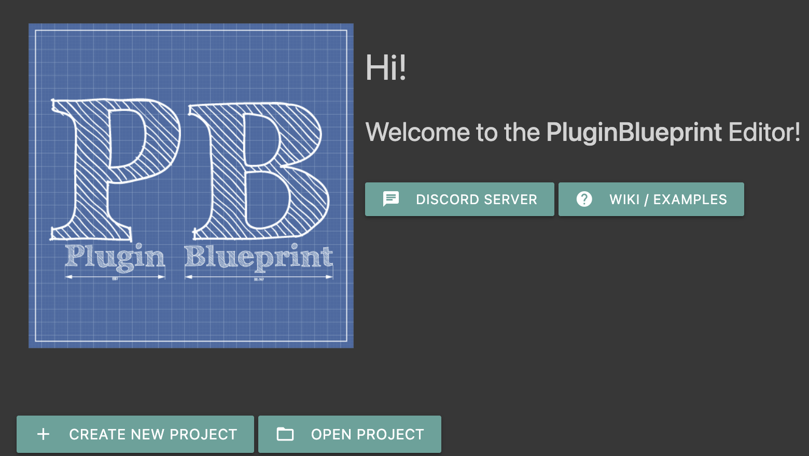
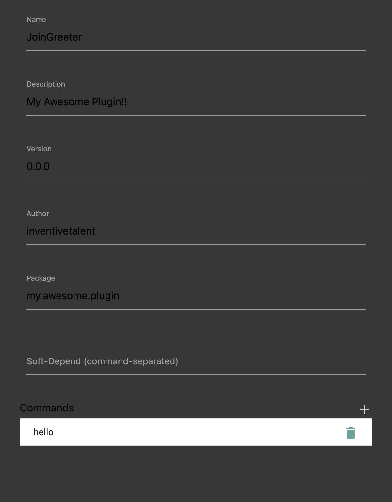

# Getting started

Install PluginBlueprint 2.0.0, create a project, and compile its starter graph.
The app builds plugins for Paper 26.3 and needs Java 25 or newer to compile.

## Download the app

1. Open [GitHub Releases](https://github.com/InventivetalentDev/PluginBlueprint/releases/latest).
2. Choose the download for your computer.

   | Platform | Download |
   | --- | --- |
   | Windows | `.exe` installer; you can choose the install folder |
   | macOS | `.dmg` or `.zip`; Apple Silicon only |
   | Linux | `.AppImage` or `.deb` |

3. Open the downloaded installer or app. If you use the Linux AppImage,
   make it executable first:

   ```sh
   chmod +x PluginBlueprint-*.AppImage
   ```

You need internet when you create a project.
If a suitable JDK is missing, the app offers to download one.
A JDK is the Java Development Kit used to compile your plugin.

## Open the unsigned app

The release apps are not code-signed. Follow the steps for your platform
if the first launch is blocked.

### macOS

1. Open the app. macOS says it was not opened.
2. Click **Done**.
3. Open **System Settings → Privacy & Security**.
4. Scroll to the **Security** section and click **Open Anyway**.
5. Confirm with your password or Touch ID, then click **Open**.

### Windows

If SmartScreen shows **Windows protected your PC**, follow these steps:

1. Click **More info**.
2. Click **Run anyway**.

## Create your first project

The start page has **Create New Project**, **Open Project**, and a list of
recent projects. It also has **Discord Server** and **Wiki / Examples**.



1. Click **Create New Project**.
2. Pick an empty folder for your project.
3. In **Give your project a name**, enter a name. This becomes the plugin name.
4. If the Java download prompt appears, click **Download**.
5. Wait for setup to finish and the editor to open.

The Java prompt says:

> PluginBlueprint needs Java 25 to build plugins. Download it now (about 200 MB)?

The buttons are **Download** and **Cancel**. The download is Eclipse Temurin,
which the app stores in its data folder.

Before offering a download, the app checks `JAVA_HOME`, then Java on `PATH`,
then its own copy. Any JDK 25 or newer works.

The app downloads the Paper 26.3 server, about 55 MB, into `<project>/lib/`
and unpacks its libraries. Unpacking takes a few seconds.
Later projects reuse the cached Paper download.
Keep internet available for later project setup too: the app checks Paper's
download metadata before using the cache.

The editor opens with a starter graph. When you run the compiled plugin,
that graph logs `Enabled <name> version <version>!` when the plugin is enabled.

### Find the app's downloaded files

The app data folder holds `jdk/` for Java and `paper/` for the Paper cache.
Its location depends on your platform:

| Platform | App data folder |
| --- | --- |
| macOS | `~/Library/Application Support/PluginBlueprint` |
| Windows | `%APPDATA%\PluginBlueprint` |
| Linux | `~/.config/PluginBlueprint` |

## Learn the editor basics

Your graph is the set of nodes and links on the canvas.
Nodes represent events, objects, method calls, and fixed values.

### Add and connect nodes

1. Double-click an empty part of the canvas to open the search box.
2. Type part of a class name, such as `PlayerJoin`, and choose a node.
3. If you need an output that is hidden, right-click the node and choose
   **Outputs**, then select the output.
4. Double-click an output to create its matching node already connected.
   For example, `getPlayer` creates a `Player` node.
5. To connect existing nodes, drag from an output to the matching input.

You can also right-click the canvas and choose **Add Node**.
Double-clicking a method output such as `sendRichMessage(String)` creates
the method node that calls it.

### Recognize the node types

Use the node's name and icon to identify its role:

| Node type | Role |
| --- | --- |
| Event node | Runs when its event fires; purple with a megaphone icon |
| Class node | Holds an object; brown |
| Method node | Calls a method; marked with a `#` icon |
| `Class{method()}` node | Implements a method, such as `onEnable()` |
| Constant node | Holds a fixed value |

`EXEC` links are orange arrows. They set the order in which nodes run.
Data links carry values, such as a player's name or a message.
Connect both kinds of links as shown in the examples.

### Set a constant

1. Double-click a `String`, number, or `boolean` input to create a connected
   constant node.
2. Right-click the constant and open **Properties**.
3. Set its value. For a Number constant, set the `type` as well as the `number`.

String constants can contain quotes and backslashes.
You don't need to remove those characters before compiling.

### Get help, save, and undo

To open a node's Javadoc, hold Shift and click the node.
Javadoc describes its class and methods. Paper classes open on `jd.papermc.io`;
Java classes open on `docs.oracle.com`.

Use these shortcuts while editing. Use Command on macOS and Control elsewhere
where the table says Ctrl/Cmd.

| Action | Shortcut or menu |
| --- | --- |
| Copy and paste | Ctrl/Cmd+C and Ctrl/Cmd+V |
| Delete selected nodes | Delete or Backspace |
| Undo | Ctrl/Cmd+Z or **Edit → Undo** |
| Redo | Ctrl/Cmd+Y or **Edit → Redo** |
| Save | Ctrl/Cmd+S or **File → Save** |

## Edit the project information

Open **Edit → Edit Project Information** to edit your plugin's details.



1. Set **Name**, **Description**, **Version**, **Author**, and **Package**
   for your plugin.
2. If you need soft dependencies, enter them in **Soft-Depend (comma-separated)**.
3. If your plugin handles commands, click **+** beside **Commands**.
   Each command has a name, description, usage, and aliases.
4. For execution highlighting during testing, leave
   **Trace node execution on the test server** checked. It is on for new projects.
5. Click **Save** to close the information window.

## Compile and find the jar

Compiling turns your graph into a plugin jar that Paper can load.

1. Choose **File → Save**.
2. Choose **Compile → Generate Code, Compile, Package**.
3. When compilation finishes, choose **Compile → Open output directory**.
4. Find `<Name>.jar` in `<project>/output/`. `<Name>` is your plugin's name.

The jar contains `plugin.yml` with `api-version: '26.3'`.
Its version matches the project's **Version**, with or without tracing.

If an error window opens, read its first `error:` line.
Click a `node_<id>` link to highlight the related node.
See [Troubleshooting](Troubleshooting.md) for the next steps.

## Continue with your plugin

1. Open [Examples](Examples.md) to import a snippet or build a recipe yourself.
2. Follow [Testing your plugin](Testing-your-Plugin.md) to run your jar on the
   built-in Paper server.
