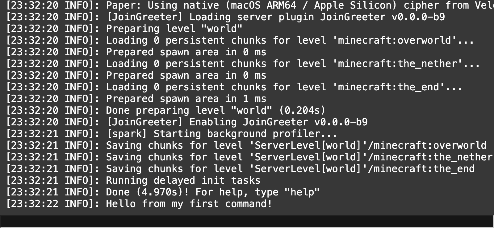

# Testing your plugin

Compile your graph before you start the built-in Paper 26.3 test server.
The server uses your last compiled jar.

## Compile and start the server

Before the first start, the app asks you to accept the [Minecraft EULA](https://aka.ms/MinecraftEULA).
Choose **Open EULA** to read it, **I agree** to start, or **Cancel** to leave the server stopped.
The app remembers your agreement and then starts the server with `-Dcom.mojang.eula.agree=true`.

1. Choose **Compile → Generate Code, Compile, Package**.
2. Choose **Run → Start Server**.
3. Wait for startup to finish in the log window.

**Run → Start Server** copies your jar from `<project>/output/` into the
server's plugin folder. It does not compile your graph.

The server listens on port `25565` and uses a maximum of 2 GB of memory
through `-Xmx2G`. After the first run, startup takes about 5 seconds.

## Use the server console

The log window shows the server console. The screenshot includes the end of
startup and the hello command's response.

1. Click the command box in the log window.
2. Type a server command, such as `op <your name>`.
   Replace `<your name>` with your Minecraft player name.
3. Press Enter to send it.

You can omit the leading `/` in this box. A leading `/` is also accepted.
For the hello example, type `hello` here or `/hello` in-game.

## Connect from Minecraft

Use Minecraft Java Edition 26.3 with your normal account.
The test server has online mode on.

1. Open **Multiplayer → Direct Connection**.
2. Enter `localhost` and connect.
3. Perform the action your graph handles, such as joining or running `/hello`.

If you need operator status, enter `op <your name>` in the log window.
If the server fails to start, check [Troubleshooting](Troubleshooting.md).

## Follow execution in the editor

New projects have **Trace node execution on the test server** checked.
With this setting, the test server starts with `-Dpluginblueprint.debug=true`.
The plugin then logs `pb_debug_exec=<node id>` each time a node runs.
The editor uses those lines to highlight the path the code took.
The built-in log window filters those debug lines out of its display.

1. Open **Edit → Edit Project Information** and check
   **Trace node execution on the test server**.
2. Click **Save**, compile, and start the server.
3. Trigger your plugin's event or command.
4. Look at the editor to follow the highlighted nodes.

Plugins built with or without tracing are safe to publish. Tracing stays off
unless the server starts with `-Dpluginblueprint.debug=true`.

## Reload a changed plugin

After changing your graph, compile before reloading:

1. Choose **Compile → Generate Code, Compile, Package**.
2. Choose **Run → Reload Plugin**.
3. Wait for the server to start again, then repeat your check.

**Run → Reload Plugin** stops the server, copies the newly compiled jar,
and starts the server again. The stop sends `stop` and waits up to 30 seconds
before killing a server that has not exited.

## Stop the server

To stop the process from the editor, choose **Run → Stop Server**.
This closes the log window and terminates the server process directly.
Closing the app also stops the server.

To request a normal console shutdown, type `stop` in the log window and press Enter.
